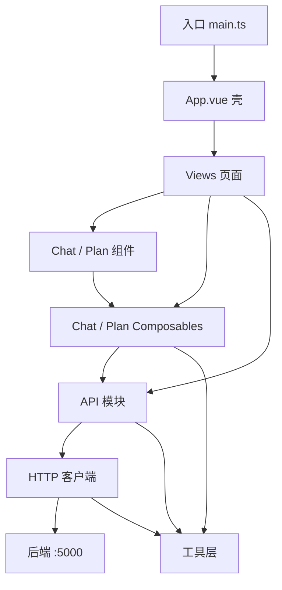
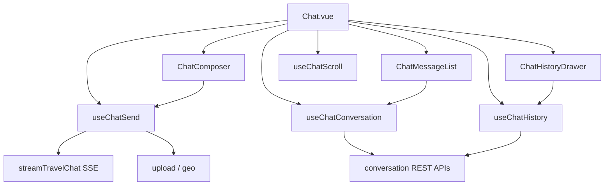
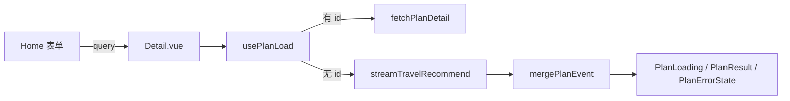

# travel-h5

Vue 3 + Vite + Vant 移动端 H5，核心能力是**行程推荐**与**多模态流式对话**。

## 技术栈

| 类别 | 选型                                        |
| ---- | ------------------------------------------- |
| 框架 | Vue 3.5、Vue Router 4、TypeScript           |
| UI   | Vant 4（自动按需引入）                      |
| 构建 | Vite 8                                      |
| 网络 | Axios（REST）+ 原生 `fetch`（SSE 流式对话） |
| 内容 | marked + DOMPurify（Markdown 渲染）         |

## 快速开始

```bash
npm install
npm run dev      # 开发：默认代理 /api → http://localhost:5000
npm run build    # 类型检查 + 生产构建
npm run preview  # 预览构建产物
```

开发时需本地后端监听 `5000` 端口（见 `vite.config.ts` 中的 proxy）。

## 分层架构

```
入口 (index.html → main.ts)
  └─ 应用壳 (App.vue：router-view + van-tabbar)
       └─ 页面 Views
            ├─ Chat / Plan 组件
            ├─ Chat / Plan Composables（业务编排）
            └─ API 模块 (auth.ts / travel/*)
                 ├─ HTTP 客户端 (axiosRequest + fetch SSE)
                 │    └─ 后端 /api → :5000
                 └─ 工具层 (auth / clientId / markdown / geo / compress)
```

依赖关系示意：



## 目录结构

```
src/
├── main.ts                 # 应用入口
├── App.vue                 # 路由出口 + 底部 TabBar
├── router/index.ts         # 路由定义
├── views/                  # 页面
│   ├── Home.vue            # 推荐入口（表单 → /detail）
│   ├── Chat.vue            # 流式对话（核心）
│   ├── Profile.vue         # 我的
│   ├── Login.vue           # 登录注册
│   ├── Detail.vue          # 行程详情 / 流式生成
│   └── PlanRecords.vue     # 行程记录列表
├── components/
│   ├── chat/               # 对话 UI
│   └── plan/               # 规划加载 / 结果 / 错误态
├── composables/
│   ├── chat/               # 对话业务编排
│   └── plan/               # 规划 SSE 合并、超时、错误分类
├── api/
│   ├── axiosRequest.ts     # Axios 实例与拦截器
│   ├── auth.ts             # 鉴权 API
│   ├── errors.ts           # ApiError / 响应错误映射
│   ├── sse.ts              # SSE JSON 消费
│   └── travel/             # 行程域 API（按能力拆分）
│       ├── index.ts
│       ├── recommend.ts / recommendStream.ts
│       ├── chat.ts / conversations.ts / plans.ts
│       ├── upload.ts / location.ts / types.ts
└── utils/
    ├── auth.ts             # Token 会话
    ├── clientId.ts         # X-Client-Id
    ├── markdown.ts         # Markdown 安全渲染
    ├── imageCompress.ts    # 图片压缩
    ├── geolocation.ts      # 定位
    └── debounce.ts
Dockerfile / nginx.conf     # 静态资源 + /api SSE 反代
```

## 路由与页面

| 路径       | 名称    | 页面        | 职责             | TabBar |
| ---------- | ------- | ----------- | ---------------- | ------ |
| `/`        | home    | Home        | 推荐入口 / 表单  | 显示   |
| `/chat`    | chat    | Chat        | 流式对话（核心） | 显示   |
| `/profile` | profile | Profile     | 用户信息 / 登出  | 显示   |
| `/login`   | login   | Login       | 登录注册         | 隐藏   |
| `/detail`  | detail  | Detail      | 行程详情         | 隐藏   |
| `/plans`   | plans   | PlanRecords | 行程记录列表     | 隐藏   |

`App.vue` 根据 `route.meta.hideTabbar` 控制底部导航显隐。

## API 面

### 鉴权 `api/auth.ts`

- `register` / `login` / `fetchMe` / `logout`

### 行程与对话 `api/travel/*`

从 `@/api/travel` 统一导出（`index.ts`）。

**REST（Axios）**

- `fetchPlans` / `fetchPlanDetail` / `deletePlan` — 行程记录
- `fetchConversations` / `fetchConversationDetail` / `createConversation` / `updateConversation` / `deleteConversation` — 会话管理
- `uploadTravelImage` — 图片上传
- `reverseGeocodeLocation` — 逆地理编码

**SSE（原生 fetch + `api/sse.ts`）**

- `streamTravelRecommend` → `POST /api/travel/recommend`  
  事件：`stage` / `meta` / `day` / `budget` / `done` / `error`（限流带 `retryAfter`）
- `streamTravelChat` → `POST /api/travel/chat`  
  按 SSE 回调 `chunk`；可传 `conversationId` 续聊，省略则后端新建并在 `done` 中回传 id

**规划载荷形状**（与后端 `recommendPrompt` / `TravelPlan` 对齐，见 `api/travel/recommend.ts`）：

| 事件 / 字段 | 形状 |
|-------------|------|
| `meta` | `{ city?, days?, totalBudget? }` |
| `day` | `{ day, date, morning, afternoon, evening }`；时段含 `spot` / `duration` / `ticket` / `transportation` / `description` |
| `budget` | `{ accommodation, food, transportation, tickets, other }`（数字） |
| `done` | 完整 `TravelPlan`；可能含 `id`、`tips`、`warnings`；`success === false` 时前端抛错 |

`mergePlanEvent`：按 `day` 号覆盖同日；`done` 整包替换局部合并结果。

**聊天 `done`**：服务端 `content` 为 `{ conversationId, content, usage }`；H5 `streamTravelChat` 只取前两者写入结果，`usage`（上下文窗口统计）目前未展示。

**上传**：`uploadTravelImage` → multipart field `file`；成功返回 `{ id, url, mime, width?, height? }`。随后 chat 只传 `{ id, type: "image" }`（最多 3）。常见失败文案来自后端：MIME 不符、>5MB、缺 `file`、附件非当前 owner。

### HTTP 客户端 `api/axiosRequest.ts`

- `baseURL: /api`
- 请求拦截：注入 `Authorization: Bearer <token>`、`X-Client-Id`
- 响应拦截：校验 `status === ok`；`401` 时清除本地会话

开发代理（`vite.config.ts`）：`/api` → `http://localhost:5000`，`timeout` / `proxyTimeout` 为 `0`，避免长 SSE 被 Vite 掐断。

## Chat 模块数据流

`Chat.vue` 组装四个 composable：发送走 SSE，会话/历史走 REST。



| Composable            | 职责                                          |
| --------------------- | --------------------------------------------- |
| `useChatConversation` | 当前会话绑定、历史消息加载、路由同步          |
| `useChatSend`         | 输入草稿、附件、场景快捷入口、流式发送 / 停止 |
| `useChatHistory`      | 会话列表抽屉、置顶 / 重命名 / 删除            |
| `useChatScroll`       | 贴底滚动与用户上滑打断                        |

## 行程规划模块

`Home.vue` 校验表单后跳转 `/detail?city&budget&days`；`Detail.vue` 通过 `usePlanLoad` 拉流或读历史。



| 模块 | 职责 |
|------|------|
| `usePlanLoad` | 连接超时、块空闲检测、总时长、限流倒计时、Abort |
| `mergePlanEvent` | 把 `meta` / `day` / `budget` / `done` 合并进局部 `TravelPlan` |
| `classifyError` / `hints` | 错误种类与用户可读提示 |
| `timeouts.ts` | 连接 12s、块空闲 15s、首包慢 8s；总超时 ≈ `30s + days×20s` |

表单约束与后端一致：预算 ≥ 100 元，天数有效正整数（后端上限 30）。

## 鉴权与匿名合并

| 本地键 | 用途 |
|--------|------|
| `travel-client-id` | 稳定 `X-Client-Id`（`utils/clientId`，首次 `randomUUID`） |
| `travel-auth-token` / `travel-auth-user` | JWT 与用户缓存（`utils/auth`） |

登录 / 注册（`api/auth.ts`）会把当前 `clientId` 一并提交；后端合并匿名会话与规划后返回 token。Axios 拦截器始终带上 Bearer（若有）与 `X-Client-Id`；`401` 清本地会话。登出调 `/auth/logout` 后仍清本地（网络失败也清）。

## 多模态场景快捷入口

Chat 空态三条入口（`composables/chat/types.ts` → `CHAT_SCENE_SHORTCUTS`）：

| sceneHint | 文案 | 默认预填 |
|-----------|------|----------|
| `spot_sign` | 景点/路牌 | 帮我看看这是哪里，值不值得去 |
| `ticket_itinerary` | 门票/行程 | 帮我识别这张票/行程单的关键信息 |
| `food_menu` | 美食/价目 | 按这份菜单帮我推荐，兼顾预算 |

`useChatSend`：选快捷入口 → 设 `sceneHint` + 预填草稿；发消息前可压缩上传图片；`spot_sign` / `food_menu` 默认尝试附带定位。结构化抽取在服务端（需 `ENABLE_SCENE_PIPELINE=1`）；H5 侧 `scenes.ts` 仅对齐类型与脱敏展示。

## 横切能力

| 能力       | 实现                                                     |
| ---------- | -------------------------------------------------------- |
| 鉴权       | `utils/auth` Token 存取；拦截器注入 `Authorization`      |
| 客户端标识 | `utils/clientId` → 请求头 `X-Client-Id`                  |
| 多模态     | `imageCompress` → `uploadTravelImage` → `sceneHint` 加权 |
| 内容渲染   | `marked` + `DOMPurify` → `renderMarkdown`                |
| 定位       | `geolocation` + 可选 `reverseGeocodeLocation`            |

## Docker

H5 镜像用 Nginx 托管静态资源，并把 `/api/` 反代到后端服务名 `server:5000`（见 `nginx.conf`）。SSE 相关：`proxy_buffering off`、读写超时 3600s。

```bash
docker build -t travel-h5 .
# 需与后端处于同一网络，且后端容器 / 服务名为 server
docker run --rm -p 8080:80 travel-h5
```

本地开发不必起 H5 容器：`npm run dev` + 本机后端 `:5000` 即可。

## 故障排查

| 现象 | 排查 |
|------|------|
| 开发时对话 / 规划卡住或中断 | 确认后端在 `:5000`；Vite proxy 超时已关，勿再套一层会缓冲 SSE 的代理 |
| 规划页一直 connecting | 12s 连接超时；检查网络与后端 `/api/heartbeat` |
| `rate_limited` 倒计时 | 后端 SSE `error.code === RATE_LIMITED`；等待 `retryAfter` 后重试 |
| Docker 下 `/api` 502 | Compose 中后端服务名须为 `server`，与 `nginx.conf` 一致 |
| 登录态丢失 | Axios 收到 `401` 会清本地 Token；核对后端 `JWT_SECRET` |
| 登录后看不到匿名会话 / 规划 | 确认注册登录请求带了同一 `travel-client-id`；换浏览器或清 localStorage 会丢匿名侧数据 |
| 场景快捷入口无结构化结果 | 后端默认关闭场景管线；需服务端 `ENABLE_SCENE_PIPELINE=1` + Vision 模型 |
| 发图报 `Invalid attachment` | 附件须属当前 owner；登录后勿引用登录前匿名上传的 id，或重新上传 |
| 上传被拒 | 仅 JPEG/PNG/WebP，≤5MB，字段名 `file`；压缩后再传（`imageCompress`） |
