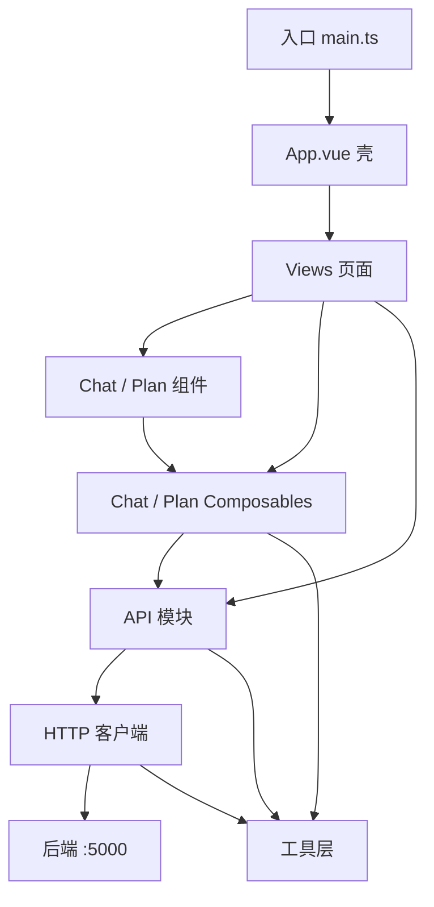
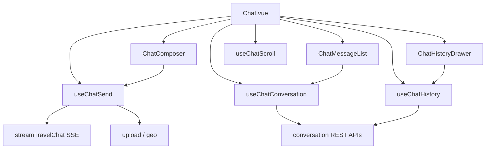
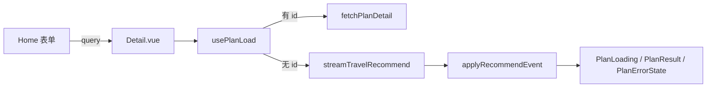

# travel-h5

Vue 3 + Vite + Vant 移动端 H5，核心能力是**行程推荐**与**多模态流式对话**。

## 技术栈

| 类别 | 选型                                        |
| ---- | ------------------------------------------- |
| 框架 | Vue 3.5、Vue Router 4、TypeScript           |
| UI   | Vant 4（自动按需引入）                      |
| 构建 | Vite 8                                      |
| 网络 | Axios（REST）+ 原生 `fetch`（SSE 流式对话） |
| 内容 | marked + DOMPurify（Markdown 渲染）         |

## 快速开始

```bash
npm install
npm run dev      # 开发：默认代理 /api → http://localhost:5000
npm run build    # 类型检查 + 生产构建
npm run preview  # 预览构建产物
```

开发时需本地后端监听 `5000` 端口（见 `vite.config.ts` 中的 proxy）。

## 分层架构

```
入口 (index.html → main.ts)
  └─ 应用壳 (App.vue：router-view + van-tabbar)
       └─ 页面 Views
            ├─ Chat / Plan 组件
            ├─ Chat / Plan Composables（业务编排）
            └─ API 模块 (auth.ts / travel/*)
                 ├─ HTTP 客户端 (axiosRequest + fetch SSE)
                 │    └─ 后端 /api → :5000
                 └─ 工具层 (auth / clientId / markdown / geo / compress)
```

依赖关系示意：



## 目录结构

```
src/
├── main.ts                 # 应用入口
├── App.vue                 # 路由出口 + 底部 TabBar
├── router/index.ts         # 路由定义
├── views/                  # 页面
│   ├── Home.vue            # 推荐入口（表单 → /detail）
│   ├── Chat.vue            # 流式对话（核心）
│   ├── Profile.vue         # 我的
│   ├── Login.vue           # 登录注册
│   ├── Detail.vue          # 行程详情 / 流式生成
│   └── PlanRecords.vue     # 行程记录列表
├── components/
│   ├── chat/               # 对话 UI
│   └── plan/               # 规划加载 / 结果 / 错误态
├── composables/
│   ├── chat/               # 对话业务编排
│   └── plan/               # 规划 SSE 合并、超时、错误分类
├── api/
│   ├── axiosRequest.ts     # Axios 实例与拦截器
│   ├── auth.ts             # 鉴权 API
│   ├── errors.ts           # ApiError / 响应错误映射
│   ├── sse.ts              # SSE JSON 消费
│   └── travel/             # 行程域 API（按能力拆分）
│       ├── index.ts
│       ├── recommend.ts / recommendStream.ts
│       ├── chat.ts / conversations.ts / plans.ts
│       ├── upload.ts / location.ts / types.ts
└── utils/
    ├── auth.ts             # Token 会话
    ├── clientId.ts         # X-Client-Id
    ├── markdown.ts         # Markdown 安全渲染
    ├── imageCompress.ts    # 图片压缩
    ├── geolocation.ts      # 定位
    └── debounce.ts
Dockerfile / nginx.conf     # 静态资源 + /api SSE 反代
```

## 路由与页面

| 路径       | 名称    | 页面        | 职责             | TabBar |
| ---------- | ------- | ----------- | ---------------- | ------ |
| `/`        | home    | Home        | 推荐入口 / 表单  | 显示   |
| `/chat`    | chat    | Chat        | 流式对话（核心） | 显示   |
| `/profile` | profile | Profile     | 用户信息 / 登出  | 显示   |
| `/login`   | login   | Login       | 登录注册         | 隐藏   |
| `/detail`  | detail  | Detail      | 行程详情         | 隐藏   |
| `/plans`   | plans   | PlanRecords | 行程记录列表     | 隐藏   |

`App.vue` 根据 `route.meta.hideTabbar` 控制底部导航显隐。

## API 面

### 鉴权 `api/auth.ts`

- `register` / `login` / `fetchMe` / `logout`

请求自动附带当前 `clientId`（与 `X-Client-Id` 同源）。成功时后端 `data` 含：

| 字段 | 说明 |
|------|------|
| `token` / `user` | JWT 与公开用户信息；`persist` 写入 localStorage |
| `mergedConversations` | 本次合并的匿名会话数；`Login.vue` 大于 0 时 toast「已同步 N 个会话」 |
| `mergedPlans` | 后端同样返回；**前端 `AuthResult` 未声明、UI 未展示**，但规划仍会合并进账号 |

`fetchMe` → `GET /auth/me`；`logout` 调 `POST /auth/logout` 后无论成败都 `clearAuthSession`。

### 行程与对话 `api/travel/*`

从 `@/api/travel` 统一导出（`index.ts`）。

**REST（Axios）**

- `fetchPlans` / `fetchPlanDetail` / `deletePlan` — 行程记录
- `fetchConversations` / `fetchConversationDetail` / `updateConversation` / `deleteConversation` — 会话管理（UI 主路径）
- `createConversation` — API 已导出，**新建对话 UI 不调用**（本地清空后首轮 `streamTravelChat` 省略 id，由后端创建）
- `uploadTravelImage` — 图片上传
- `reverseGeocodeLocation(lat, lon)` — `GET /api/travel/location/reverse`；成功形状 `{ lat, lon, city, displayName }`

**规划记录**（`api/travel/plans.ts` → `/travel/plans`）：

| API | 返回 |
|-----|------|
| `fetchPlans` | `PlanSummary[]`：`id` / `city` / `days` / `totalBudget` / `title` / `createdAt` / `updatedAt` |
| `fetchPlanDetail(id)` | `PlanDetail` = Summary + `plan: TravelPlan`；无数据抛错 |
| `deletePlan(id)` | 无 body；成功后列表页本地 filter 掉该项 |

`title` 由后端派生（`{city}行程规划 · {days}天`）。`PlanRecords` 点进详情走 `/detail?id=` → `usePlanLoad` 读 `fetchPlanDetail`（不再 SSE）。生成规划时需带同一 `X-Client-Id`，否则 `done` 可能无 `id`、记录列表为空。

**会话 PATCH**（`updateConversation` → `PATCH /travel/conversations/:id`）：

| 字段 | 用法 |
|------|------|
| `title?` | 重命名；前端先 trim，空串本地拦截；后端再截断至 40 字 |
| `pinned?` | 置顶 / 取消置顶；`useChatHistory.togglePinConversation` 取反后写回 |

列表：服务端已按 `pinned DESC, updatedAt DESC`；抽屉打开后 `sortConversations` 再排一次（同规则）。摘要含 `preview`（最近消息文本或 `[图片]`）。

**SSE（原生 fetch + `api/sse.ts`）**

- `streamTravelRecommend` → `POST /api/travel/recommend`  
  事件：`stage` / `meta` / `day` / `budget` / `done` / `error`（限流带 `retryAfter`）
- `streamTravelChat` → `POST /api/travel/chat`  
  按 SSE 回调 `chunk`；可传 `conversationId` 续聊，省略则后端新建并在 `done` 中回传 id

**聊天请求可选字段**（`streamTravelChat` / `ChatLocationPayload`）：

| 字段 | 说明 |
|------|------|
| `attachments` | `{ id, type: "image" }[]`，最多 3 |
| `sceneHint` | `spot_sign` / `ticket_itinerary` / `food_menu` |
| `location` | `{ lat, lon, accuracy?, city?, displayName? }`；仅在 `needsUserLocation` 或场景入口触发定位后附带 |

`lat`/`lon` 为数字才会被后端接受；`city`/`displayName` 来自前端 `reverseGeocodeLocation`，失败时仍可只传坐标（后端可能再逆地理一次，失败 soft-fail）。

**规划载荷形状**（与后端 `recommendPrompt` / `TravelPlan` 对齐，见 `api/travel/recommend.ts`）：

| 事件 / 字段 | 形状 |
|-------------|------|
| `meta` | `{ city?, days?, totalBudget? }` |
| `day` | `{ day, date, morning, afternoon, evening }`；时段含 `spot` / `duration` / `ticket` / `transportation` / `description` |
| `budget` | `{ accommodation, food, transportation, tickets, other }`（数字） |
| `done` | 完整 `TravelPlan`；可能含 `id`、`tips`、`warnings`；`success === false` 时前端抛错 |

`applyRecommendEvent`（文件 `mergePlanEvent.ts`）：按 `day` 号覆盖同日；`done` 整包替换局部合并结果。

**聊天 `done`**：服务端 `content` 为 `{ conversationId, content, usage }`；H5 `streamTravelChat` 只取前两者写入结果，`usage`（上下文窗口统计）目前未展示。

**上传**：`uploadTravelImage` → multipart field `file`（Axios 须去掉默认 `Content-Type`，让浏览器带 boundary）；成功返回 `{ id, url, mime, width?, height? }`。`url` 为后端相对路径 `/api/travel/uploads/files/<id>`，经 Vite/Nginx 同源反代可读；后端对该 GET **无鉴权**且 `Cache-Control` 约一年 immutable。随后 chat 只传 `{ id, type: "image" }`（最多 3）。常见失败文案来自后端：MIME 不符、>5MB、缺 `file`、附件非当前 owner。

### HTTP 客户端 `api/axiosRequest.ts`

- `baseURL: /api`
- REST `timeout: 120000`（120s）
- 请求拦截：注入 `Authorization: Bearer <token>`、`X-Client-Id`
- 响应拦截：校验 `status === ok`；`401` 时清除本地会话

开发代理（`vite.config.ts`）：`/api` → `http://localhost:5000`，`timeout` / `proxyTimeout` 为 `0`，避免长 SSE 被 Vite 掐断。Chat SSE 错误多为原始 `Error`（无 `ApiError.kind`）；规划 SSE 才映射 `RATE_LIMITED` / `PARSE_FAILED`。

## Chat 模块数据流

`Chat.vue` 组装四个 composable：发送走 SSE，会话/历史走 REST。



| Composable            | 职责                                          |
| --------------------- | --------------------------------------------- |
| `useChatConversation` | 当前会话绑定、历史消息加载、路由同步          |
| `useChatSend`         | 输入草稿、附件、场景快捷入口、流式发送 / 停止 |
| `useChatHistory`      | 会话列表抽屉、长按菜单、置顶 / 内联重命名 / 删除 |
| `useChatScroll`       | 贴底滚动与用户上滑打断                        |

**会话路由契约**：加载 / 续聊以 `/chat?id=` 为准（`router.replace` 同步）。「新对话」只做本地 `resetToEmptyChat`（清消息、清 query），**不**调 `createConversation`；首条消息省略 `conversationId`，后端创建后经 `done` → `bindConversationId` 写回路由。

`useChatSend`：发出后 `thinking=true` 直至首个 chunk；按钮切换为「停止」→ `AbortController.abort()`，**保留已展示 partial**，不弹错误 toast。助手 Markdown 更新另经 rAF 合并（与滚动 rAF 独立）。

`useChatScroll`（`composables/chat/useChatScroll.ts`）：距底 ≤ `BOTTOM_THRESHOLD`（80px）视为贴底并置 `stickToBottom`；用户上滑后内容更新不再自动滚。流式 chunk 经 `requestAnimationFrame` 合并为一帧最多滚一次；`scrollTop` 即时赋值（避免 `smooth` 排队误判），并在下一帧再贴一次以适配 Markdown 布局结算。强制滚底传 `{ force: true }`（如切会话）。

历史抽屉交互（`useChatHistory`）：长按条目弹出菜单 → 置顶、重命名、删除；重命名为行内输入，Enter 提交 / Esc 取消；删除当前会话会重置到空聊并清路由。`travel-last-conversation-id` 仅在绑定/清空时 **写入或删除**，进页**不会** `getItem` 自动恢复——恢复靠 `/chat?id=` 或历史抽屉点选。

## 行程规划模块

`Home.vue` 校验表单后跳转 `/detail?city&budget&days`；`Detail.vue` 通过 `usePlanLoad` 拉流或读历史。



| 模块 | 职责 |
|------|------|
| `usePlanLoad` | 连接超时、块空闲检测、总时长、限流倒计时、Abort |
| `applyRecommendEvent` | 把 `meta` / `day` / `budget` / `done` 合并进局部 `TravelPlan` |
| `classifyError` / `hints` | 错误种类与用户可读提示 |
| `timeouts.ts` | 连接 12s、块空闲 15s、首包慢 8s；总超时 ≈ `30s + days×20s` |

`PlanLoadState`：`connecting` → `waiting_ttft` / `slow_ttft` → `streaming` / `idle_gap` → `success` | `failed` | `rate_limited`；用户取消记为 `canceled`。历史详情硬超时 **30s**；生成路径用 `totalTimeoutMs(days)`。

表单约束：前端天数 **1–30**、预算 ≥ 100，与后端一致。

## 鉴权与匿名合并

| 本地键 | 用途 |
|--------|------|
| `travel-client-id` | 稳定 `X-Client-Id`（`utils/clientId`，首次 `randomUUID`） |
| `travel-auth-token` / `travel-auth-user` | JWT 与用户缓存（`utils/auth`） |
| `travel-last-conversation-id` | 绑定会话时写入；**当前 UI 不读它恢复**，恢复靠 `/chat?id=` |

登录 / 注册（`api/auth.ts`）会把当前 `clientId` 一并提交；后端合并匿名会话与规划后返回 token + `mergedConversations` / `mergedPlans`。Axios 拦截器始终带上 Bearer（若有）与 `X-Client-Id`；`401` 清本地会话。登出调 `/auth/logout` 后仍清本地（网络失败也清）。REST 错误经 `api/errors.ts` 归类为 `timeout` / `rate_limited` / `network` / `auth` / `server` / `unknown`（`ApiError.kind`）。

约束与后端一致：账号为大陆手机号或邮箱；密码 ≥ 6；注册可选昵称。`Login.vue` 仅根据 `mergedConversations` 提示同步会话——规划合并无单独 toast，可在「规划记录」页确认。

## 多模态场景快捷入口

Chat 空态三条入口（`composables/chat/types.ts` → `CHAT_SCENE_SHORTCUTS`）：

| sceneHint | 文案 | 默认预填 |
|-----------|------|----------|
| `spot_sign` | 景点/路牌 | 帮我看看这是哪里，值不值得去 |
| `ticket_itinerary` | 门票/行程 | 帮我识别这张票/行程单的关键信息 |
| `food_menu` | 美食/价目 | 按这份菜单帮我推荐，兼顾预算 |

`useChatSend`：选快捷入口 → 设 `sceneHint` + 预填草稿；发消息前可压缩上传图片；`spot_sign` / `food_menu` 默认尝试附带定位。结构化抽取在服务端（需 `ENABLE_SCENE_PIPELINE=1`）；H5 侧 `scenes.ts` 仅对齐类型与脱敏展示。

## 横切能力

| 能力       | 实现                                                     |
| ---------- | -------------------------------------------------------- |
| 鉴权       | `utils/auth` Token 存取；拦截器注入 `Authorization`      |
| 客户端标识 | `utils/clientId` → 请求头 `X-Client-Id`                  |
| 多模态     | `imageCompress` → `uploadTravelImage` → `sceneHint` 加权 |
| 内容渲染   | `marked` + `DOMPurify` → `renderMarkdown`                |
| 定位       | `utils/geolocation`：按需 `getUserLocation`，缓存 10min；反查失败仍返回 lat/lon |

**图片压缩**（`utils/imageCompress.ts`，发送前强制走）：

| 约束 | 值 |
|------|----|
| 允许 MIME | JPEG / PNG / WebP |
| 每轮附件上限 | `MAX_ATTACHMENTS_PER_SEND = 3` |
| 压缩后大小 | ≤ 5MB（与后端 `MAX_UPLOAD_BYTES` 对齐） |
| 长边 | ≤ 1600px |
| 输出 | 一律 JPEG，质量起 0.8，超限逐步降到 ≥0.4；透明图铺白底 |

**何时附带定位**（`needsUserLocation`，避免进页弹权限）：

- 文案匹配「附近 / 当前位置 / 当地」等显式意图；或
- 问天气/出行类且未点名已知城市列表中的目的地

定位超时 8s，`maximumAge` / 缓存 TTL 均为 10min，并发请求合并为单次 inflight；反查走 `reverseGeocodeLocation`。失败只打 warn，chat 仍可只带坐标或完全不带 `location`。Profile 页进页调 `fetchMe` 刷新缓存用户；失败清本地会话；部分菜单项仍为「功能开发中」占位。

## Docker

H5 镜像：Node 20 构建静态资源，Nginx 托管；`try_files` 回退 `index.html`（SPA）；静态资源 `expires 7d` + immutable。`/api/` 反代到后端服务名 `server:5000`（见 `nginx.conf`）。SSE：`proxy_buffering off`、读写超时 3600s。镜像 `HEALTHCHECK` 探测 `/`。

```bash
docker build -t travel-h5 .
# 需与后端处于同一网络，且后端容器 / 服务名为 server
docker run --rm -p 8080:80 travel-h5
```

本地开发不必起 H5 容器：`npm run dev` + 本机后端 `:5000` 即可。

## 故障排查

| 现象 | 排查 |
|------|------|
| 开发时对话 / 规划卡住或中断 | 确认后端在 `:5000`；Vite proxy 超时已关，勿再套一层会缓冲 SSE 的代理 |
| 规划页一直 connecting | 12s 连接超时；检查网络与后端 `/api/heartbeat` |
| `rate_limited` 倒计时 | 后端 SSE `error.code === RATE_LIMITED`；等待 `retryAfter` 后重试 |
| Docker 下 `/api` 502 | Compose 中后端服务名须为 `server`，与 `nginx.conf` 一致 |
| 登录态丢失 | Axios 收到 `401` 会清本地 Token；核对后端 `JWT_SECRET` |
| 登录后看不到匿名会话 / 规划 | 确认注册登录请求带了同一 `travel-client-id`；换浏览器或清 localStorage 会丢匿名侧数据 |
| 登录 toast 只提会话、规划却已在 | 预期行为：UI 只读 `mergedConversations`；`mergedPlans` 仍由后端合并，打开规划记录页核对 |
| 登录后旧附件 Invalid attachment | 后端不合并 uploads；须重新上传（与会话/规划合并无关） |
| 图片 URL 可开但发送报 Invalid attachment | 读文件接口不校验 owner；chat 引用须属当前登录/匿名身份，登录后勿复用登录前匿名上传 id |
| 场景快捷入口无结构化结果 | 后端默认关闭场景管线；需服务端 `ENABLE_SCENE_PIPELINE=1` + Vision 模型 |
| 发图报 `Invalid attachment` | 附件须属当前 owner；登录后勿引用登录前匿名上传的 id，或重新上传 |
| 上传被拒 | 仅 JPEG/PNG/WebP，≤5MB，字段名 `file`；压缩后再传（`imageCompress`） |
| 一次选太多图 | 前端每轮最多 3 张（`MAX_ATTACHMENTS_PER_SEND`） |
| 流式时滚不到底 / 乱跳 | 上滑后 `stickToBottom=false` 是预期；贴底阈值 80px；勿改成 `scrollIntoView({behavior:'smooth'})` |
| 有定位无城市名 | 反查 502/超时；消息仍可发送，仅缺 `city`/`displayName`；查后端出站与 Nominatim UA |
| 浏览器不弹定位 | 仅当 `needsUserLocation` 或场景快捷入口触发；HTTPS / 本机权限需已允许 |
| `/plans` 列表为空 | 生成时未带 `travel-client-id`，或 SSE `done` 无 `id`（落库失败）；与登录合并用同一 clientId |
| 点开记录无详情 | `fetchPlanDetail` 404：记录属其他 owner，或匿名/登录身份切换后 client 不一致 |
| 置顶后顺序乱 | 前端与后端均为置顶优先 + `updatedAt` 降序；刷新抽屉会重新 `fetchConversations` |
| 重命名失败 | 空标题本地拦截；后端空串 400；超长由服务端截到 40 字 |
| 进 Chat 没有上次会话 | 预期：须带 `/chat?id=` 或从历史抽屉打开；`travel-last-conversation-id` 不会自动恢复 |
| 点「新对话」却调了 createConversation | UI 不会调；首轮 SSE 省略 id 即可 |
| 停止生成后气泡半截 | 预期：abort 保留 partial，与后端可能落库部分助手消息一致 |
| Profile 显示未登录但有 Token | `fetchMe` 失败会清会话；核对后端 `JWT_SECRET` / Token 是否过期 |
